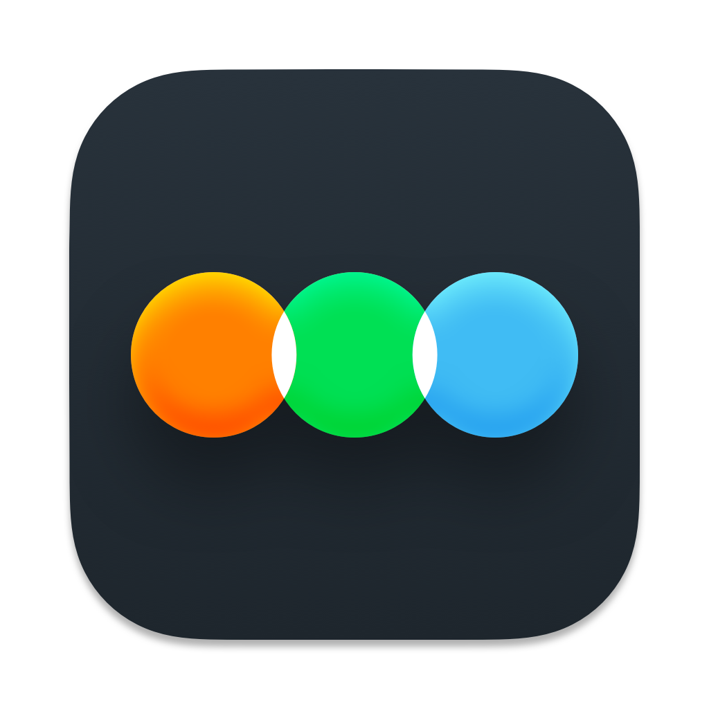
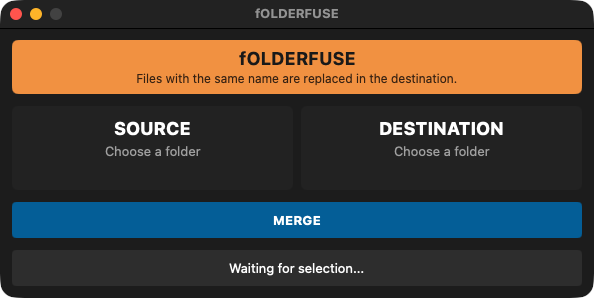

<p align="center"></p>

# fOLDERFUSE

**Merges one folder into another the way Windows does it — files with the same name are replaced.**  
*Fusionne un dossier dans un autre comme sous Windows — les fichiers de même nom sont remplacés.*

🇬🇧 [English](#-english) · 🇫🇷 [Français](#-français)

---
## 🇬🇧 English

### What it does

In the Finder, copying a folder onto another one with the same name replaces the whole folder. Modders expect a merge. fOLDERFUSE merges the content of a source folder into a destination, replacing same-name files and keeping everything else.

### Features

- Windows-style merge: same-name files replaced, other files kept, source folder untouched.
- Summary before merging: number of files replaced and their current size.
- Free space check on the destination; on the same volume, files are cloned without using extra space.
- Progress, stall detection and clean stop at any time.
- Native Swift app, about 1 MB.
- Interface in **English, French, Italian and Spanish** (follows your Mac's language).

### What's new in 1.0.1


### Updates

From version 1.0.1 the app checks once a day whether a newer release exists on GitHub and offers to open the Nexus page, remind you later or skip that version. Nothing is downloaded or installed automatically. The full history is in [CHANGELOG.md](CHANGELOG.md).

### Screenshots


*Source, destination, merge*

### Requirements

A Mac with **Apple Silicon** (M1 or later), **macOS 15 Sequoia** or later. No Python, no Wine, no virtual machine needed.

### Installation

1. Download the zip from Nexus Mods (or from the GitHub releases) and unzip it.
2. Move **fOLDERFUSE.app** to your **Applications** folder.
3. First launch: the app is signed with a personal certificate but **not notarized by Apple**, so macOS blocks it. Open **System Settings → Privacy & Security**, scroll down and click **Open Anyway** next to fOLDERFUSE, then confirm. On macOS 14 or earlier you can also right-click the app → **Open** → **Open**.
4. Still blocked? In Terminal: `xattr -dr com.apple.quarantine /Applications/fOLDERFUSE.app`

### How to use

1. Choose the **SOURCE** folder, then the **DESTINATION** folder.
2. Click **MERGE**, read the summary and confirm.

### Building from source

Requires the Xcode command line tools (Swift). From the repository folder:

```bash
./build_app.sh
```

### License

Released under the **MIT License**: free to use, modify and share. Part of the **Skyrim Mac Toolkit**, a set of modding tools built for Skyrim players on Mac.

---

## 🇫🇷 Français

### À quoi ça sert

Dans le Finder, copier un dossier sur un autre du même nom remplace tout le dossier. Les moddeurs attendent une fusion. fOLDERFUSE fusionne le contenu d'un dossier source dans une destination, en remplaçant les fichiers de même nom et en gardant tout le reste.

### Fonctions

- Fusion à la Windows : fichiers de même nom remplacés, autres fichiers conservés, dossier source intact.
- Résumé avant fusion : nombre de fichiers remplacés et leur taille actuelle.
- Vérification de l'espace libre ; sur le même volume, les fichiers sont clonés sans occuper d'espace.
- Progression, détection des blocages et arrêt propre à tout moment.
- Appli Swift native d'environ 1 Mo.
- Interface en **français, anglais, italien et espagnol** (suit la langue du Mac).

### Nouveautés de la 1.0.1


### Mises à jour

À partir de la version 1.0.1, l'appli vérifie une fois par jour si une version plus récente existe sur GitHub et propose d'ouvrir la page Nexus, de rappeler plus tard ou d'ignorer cette version. Rien n'est téléchargé ni installé automatiquement. L'historique complet est dans [CHANGELOG.md](CHANGELOG.md).

### Captures d'écran


*Source, destination, fusion*

### Configuration requise

Un Mac **Apple Silicon** (M1 ou plus récent), **macOS 15 Sequoia** ou plus récent. Ni Python, ni Wine, ni machine virtuelle.

### Installation

1. Téléchargez le zip sur Nexus Mods (ou dans les releases GitHub) et décompressez-le.
2. Placez **fOLDERFUSE.app** dans votre dossier **Applications**.
3. Premier lancement : l'appli est signée avec un certificat personnel mais **pas notarisée par Apple**, macOS la bloque donc. Ouvrez **Réglages Système → Confidentialité et sécurité**, descendez et cliquez sur **Ouvrir quand même** à côté de fOLDERFUSE, puis confirmez. Sous macOS 14 ou antérieur, vous pouvez aussi faire clic droit sur l'appli → **Ouvrir** → **Ouvrir**.
4. Toujours bloquée ? Dans le Terminal : `xattr -dr com.apple.quarantine /Applications/fOLDERFUSE.app`

### Utilisation

1. Choisissez le dossier **SOURCE**, puis le dossier **DESTINATION**.
2. Cliquez sur **FUSIONNER**, lisez le résumé et confirmez.

### Compiler depuis les sources

Nécessite les outils en ligne de commande de Xcode (Swift). Depuis le dossier du dépôt :

```bash
./build_app.sh
```

### Licence

Publié sous **licence MIT** : libre d'utilisation, de modification et de partage. Fait partie du **Skyrim Mac Toolkit**, un ensemble d'outils de modding pensés pour les joueurs de Skyrim sur Mac.
